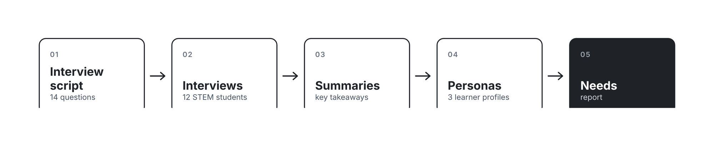
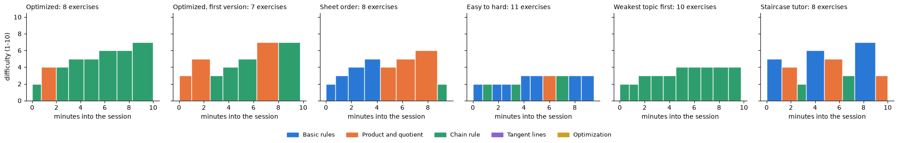
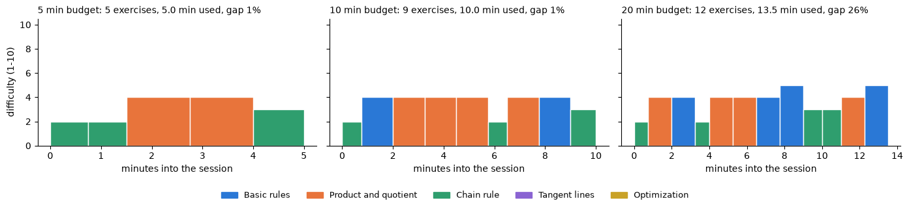

<h1 align="center">When Is Help Actually Helpful?</h1>

<strong>Development Blog</strong>

Group 3 · Human Computer Interaction (HS26) · ETH Zürich

Franco Fierro Brandes · Nicolas Ribeiro · Noah Faoro  
Rafael Bragança Oliveira · Reto Russmann · Valentin Fontana

> [!NOTE]
> **In short:** We want to understand how students get help when they are stuck on STEM problems, and how that help can support learning instead of replacing it, especially now that AI is the default place to ask. This blog documents our process, milestone by milestone.

## Table of Contents

1. [Project description](#project-description)
2. [Needfinding (Milestone 1)](#needfinding-milestone-1)
   - [Goal and approach](#goal-and-approach)
   - [Interviews](#interviews)
   - [Personas](#personas)
   - [Needs](#needs)
   - [Meta-reflection](#meta-reflection)
3. [Ideation (Milestone 2)](#ideation-milestone-2)
4. [UI Optimization (Milestone 3)](#ui-optimization-milestone-3)
   - [The optimization task](#the-optimization-task)
   - [The resulting design](#the-resulting-design)
   - [Why it is better than the alternatives](#why-it-is-better-than-the-alternatives)
   - [What we learned](#what-we-learned)
   - [Meta-reflection (Milestone 3)](#meta-reflection-milestone-3)
5. [Hi-Fi Prototype & Evaluation (Milestone 4)](#hi-fi-prototype--evaluation-milestone-4)

---

## Project description

Our course theme is **Rethinking Studying with AI**. We started from the working question:

> How might AI support students when they need help without unnecessarily taking over the learning work?

Students now have an always-available helper for almost any problem they get stuck on. That can be great, but it also makes it easy to hand over exactly the work that produces learning. We focus on STEM students, whose courses are problem-solving heavy, and we study help in general, not only AI, because the way students seek and judge help from friends, teaching assistants or course material shows what good AI support would need to look like.

---

## Needfinding (Milestone 1)

> [!TIP]
> **Deliverables:** [Needfinding report](milestones/m1-need-finding/submission/g3-need-finding-report.pdf) (interview summary, personas and needs) · [Supplementary materials](milestones/m1-need-finding/submission/g3-supplementary-materials.pdf) (interview script and summaries)

### Goal and approach

Our goal was to understand what makes help useful for STEM students, and what makes it fall short, when they are trying to learn or solve problems. We deliberately framed the interviews around help in general rather than AI, hoping that the way students seek and judge help from other sources would show us how AI support could become more useful for learning.

  

### Interviews

We interviewed **12 STEM students** (mostly BSc, plus one Master's student and one recent graduate) using convenience sampling among friends and colleagues. We avoided interviewing only Computer Science students, so the sample spans four areas:

| Area | Fields of study | Interviews |
|---|---|:---:|
| **Health and life sciences** | Medicine, Pharmacy, Computational Biology | 3 |
| **Engineering** | Mechanical (2), Electrical, Industrial, Robotics | 5 |
| **Mathematics and finance** | Mathematics, Quantitative Finance | 2 |
| **Computing and information** | Computer Science, Information Systems | 2 |

The interview followed four steps: **profiling** (field, difficulty, how quickly they seek help), **a concrete example** (the last time they got really stuck), **what made help useful and what made it fall short**, and **reflection** (what keeps them feeling that they are solving the problem themselves). 

What we took away:

| | |
|---|---|
| **AI is the default source of help** | **Overly complex help backfires** |
| Every participant brought it up on their own. | Long explanations, or ones that assume knowledge students do not have yet, lead to frustration. |
| **Step-by-step help feels more natural** | **Sometimes pointing the way is enough** |
| Students prefer small steps that leave part of the work to them. | Pointing to where in the course material to look can beat giving the answer. |

The full interview script and a summary of each interview are in our [supplementary materials](milestones/m1-need-finding/submission/g3-supplementary-materials.pdf). We do not publish recordings or names, and participants appear only by role or code.

### Personas

We created three personas from the interview findings. Each has its own page in the [Needfinding report](milestones/m1-need-finding/submission/g3-need-finding-report.pdf):

- **Sofia, the Efficiency-Seeking Learner**: tries first, then wants a quick hint, and gets frustrated by long answers or full solutions when a nudge was enough.
- **Peter, the Deadline-Driven Learner**: wants to understand, but under time pressure asks for complete solutions and later wonders what he actually learned.
- **Max, the Validation-Seeking Learner**: starts with his own approach and uses AI as a quick sanity check, but worries about depending on external confirmation.

### Needs

From the twelve interviews we identified five key needs and eight secondary ones. The key needs are:

1. **Short, step-by-step help that goes deeper on request.** Long answers that arrive all at once confuse students more than they help.
2. **Help that matches what the student already knows.** Answers that assume knowledge the student lacks force them to explain and prompt again.
3. **Help grounded in the course material.** Students want AI to know their lectures and point back to them, instead of bringing in outside content.
4. **Support that keeps the student doing the thinking.** Students want hints and checks of their own reasoning, not finished solutions.
5. **Knowing when not to trust the AI.** Some students trust AI over friends, while others catch hallucinations, and both need ways to verify answers.

The secondary needs, the evidence behind each need and our critical reflection are in the [Needfinding report](milestones/m1-need-finding/submission/g3-need-finding-report.pdf).

### Meta-reflection

Going into need finding, our main worry was that we would end up confirming what we already believed. Most of us use AI to study every day, so it would have been easy to write questions that led straight to "AI helps, AI hurts". **What worked best was framing the whole interview around help in general**, not around AI. We asked about the last time someone got really stuck, who they turned to, and what made that help useful or not, and we never mentioned AI ourselves. All 12 participants brought it up on their own, which told us more about how central AI has become than any direct question could have. Starting from a concrete story before asking for opinions also gave us more honest material, because people described what they actually did, not what they thought they should do.

**Our sampling also helped.** We interviewed friends and colleagues, but deliberately avoided interviewing only Computer Science students. Talking to people from Medicine, Mechanical Engineering, Quantitative Finance and others kept us from hearing only what a CS student would say, and it showed how differently the same behaviour looks across fields: some students ask for help immediately, others try for 15 minutes first, and they describe very different relationships with the same tools.

Our interview script also changed along the way. The first draft reached 17 questions, which was too much for a 15 to 20 minute interview, so we adapted it and became more strategic about which questions mattered most for our goal, ending with 14 (see our supplementary materials). Looking back, we would go further in that direction next time: start from a short script, test it in a pilot interview, and agree on one summary template before the first interview, so that our material fits together from the start.

**Looking at other methods, observation would add the most.** Everything we know comes from what people told us about their past behaviour. A think-aloud session, where a student solves a real problem while we watch when and how they turn to help, would show us moments they do not remember or do not want to admit. A diary study over exam preparation would show how help-seeking changes as deadlines approach, and a short survey built on our patterns could tell us how common they are, which 12 interviews cannot.

**We also leave need finding with open questions.** We do not know how far our findings go beyond STEM students at a few European universities, or whether students who say they would prefer hints over full solutions would really choose them under deadline pressure. We also wonder how much of "AI feels more helpful" comes from the tool itself and how much from the low social cost of asking it. We want our ideation and prototypes to start testing these questions in Milestone 2.

---

## Ideation (Milestone 2)

Coming with Milestone 2.

---

## UI Optimization (Milestone 3)

> [!TIP]
> **Deliverables:** [UI Optimization report](milestones/m3-ui-optimization/UI%20Optimization.pdf) (the optimization and its key findings) · [Optimization notebook](milestones/m3-ui-optimization/code/ui_optimization.ipynb) (the code, with all results) · [Requirements](milestones/m3-ui-optimization/code/requirements.txt)

### The optimization task

Our interviews showed that students under time pressure still need to learn and not only finish, that they need room to struggle before help arrives, and that they need to understand an idea well enough to solve similar problems alone. Well-chosen practice supports all three, but with only a few minutes someone has to decide **which exercises to do, and in which order**. This is the decision we optimize.

The right exercise is not too easy, because it teaches nothing, and not too hard, because it frustrates and invites handing the problem over to someone else. What is right also changes while the student practices: their level rises, a student who just failed needs a related exercise, and two near-identical exercises waste time. A fixed rule such as "easy to hard" cannot weigh all of this for each student, so we formulated it as an **integer program** and solved it with Gurobi:

- **Design variables:** for each position of the path, which exercise is placed there.
- **Constraints:** each exercise at most once, no gaps, and the total time within the budget (5, 10 or 20 minutes).
- **Objective:** the learning gained over the session, estimated from the student's self-rating and results, with penalties for near-duplicate and generated exercises and a bonus for exercises related to one just failed. The modelled level of the student rises along the path, so an easier exercise early makes a harder one more valuable later.

The exercise bank is an input. In use it would be built from the student's own exercises plus exercises generated by a language model to fill gaps. Our Calculus bank of 100 exercises is one example of what such a bank looks like. All data in this milestone are made up. The full formulation is in Sections 2 and 3 of the [report](milestones/m3-ui-optimization/UI%20Optimization.pdf) and in Sections 3 and 4 of the [notebook](milestones/m3-ui-optimization/code/ui_optimization.ipynb).

### The resulting design

For an example student with 10 minutes who rated basic rules 5, product and quotient 4 and chain rule 2, the solver returns a path of nine exercises and proves it is within 1% of the optimum. It starts with easy chain-rule exercises, the topic the student rated lowest, and moves to harder ones in the other two. The figure shows how each design would continue if every answer were correct: the optimized design is re-planned after each answer, so its difficulty rises with the modelled level.

  

The optimized path is one variant of our A/B study in Milestone 4. More on how it changes with the time budget (5, 10 and 20 minutes) is in Section 7 of the [notebook](milestones/m3-ui-optimization/code/ui_optimization.ipynb).

  

### Why it is better than the alternatives

We compared the optimized design with four designs a person could make: **sheet order**, **easy to hard**, **weakest topic first** and a **staircase tutor** that goes up one level after a clean solve and down after a miss. We simulated 20 students. Each has a true ability per topic that the planner cannot see, and a self-rating that is the true ability plus a random error, because real self-assessments are rarely exact. We used two assumed learning worlds and measured the mean true ability gain per topic. In the **ramp** world a student learns more from exercises further above their level. In the **peak** world they learn most when the chance of success is about one half.

| Design | "ramp" world | "peak" world |
|---|:---:|:---:|
| **Optimized** | **0.234** | 0.260 |
| Sheet order | 0.115 | 0.225 |
| Easy to hard | 0.083 | 0.214 |
| Weakest topic first | 0.199 | 0.280 |
| Staircase tutor | 0.184 | 0.260 |

In the "ramp" world the optimized design clearly beats sheet order and easy to hard, which ignore the student. Its difference to weakest topic first and the staircase is within the noise, and in the "peak" world, which is closest to what the optimizer assumes, all designs are within noise. The rules also ignore near-duplicates: the first plan of the optimized design repeats a skill 0.4 times per plan against 1.4 to 6.1 for the rules. On the other hand, it uses 86% of the time budget against 94 to 98%, and a larger share of generated exercises than easy to hard. These trade-offs depend on weights that are our assumptions. The analysis is in Section 4 of the [report](milestones/m3-ui-optimization/UI%20Optimization.pdf) and in Sections 6 to 8 of the [notebook](milestones/m3-ui-optimization/code/ui_optimization.ipynb), which also checks the solver against brute force on small cases.

### What we learned

**Our first version left topics out.** It kept the 12 best exercises overall as candidates to keep the model small, and a student with five topics got a plan of almost only one topic. We now keep the best four of each topic, and over 14 random students the number of topics covered rose from 2.1 to 2.8. **The solver is the bottleneck for long sessions**: with the learning-progress constraints, 10 and 20 minutes are not always solved to proven optimality, so the plan is recomputed after every answer. **The constants are assumptions.** In Milestone 4 we will record success and time per exercise to estimate them from data instead of assuming them.

### Meta-reflection (Milestone 3)

**We did not start with the learning path.** Our app had one main feature, a chat where students ask questions and consult the material, and solving exercises was part of that chat. When we tried to optimize it, the optimization got confusing: we could not tell which chat answers were normal answers and which were answers to an exercise. So we **separated the chat from the exercises** and created the Exercise mode, to optimize inside it. Our next idea was to optimize the structure of a single exercise. After talking to the TAs we decided that a **learning path** was more interesting: with a bank of exercises, decide the best path to maximize the learning gained by the student.

**The hardest part was making assumptions.** It is not clear what is most effective for the learning rate, or which order of exercises matters most, so we had to assume. What helped was starting from ideas about how people learn. For example, if a student fails an exercise, it is useful that one of the next exercises is similar, to help them with the problem they were stuck on. Ideas like this became terms of the objective and made the problem much easier to formulate.

**We think the optimizer is useful for the student, and not only for this course.** Deciding which exercises to do is one more thing that takes the student's time, and the best path is not obvious. An optimizer that proposes it saves that time, and it does so with the time budget the student has. We will see in Milestone 4 whether students feel the same.

An LLM helped us build the exercise banks, gave us ideas for constraints, and helped us turn what we were thinking into mathematics and then into a working Gurobi model. The main decisions were ours: separating the chat from the exercises, choosing the learning path, the idea of following a failed exercise with a similar one, and what the objective should reward.

---

## Hi-Fi Prototype & Evaluation (Milestone 4)

Coming with Milestone 4.
