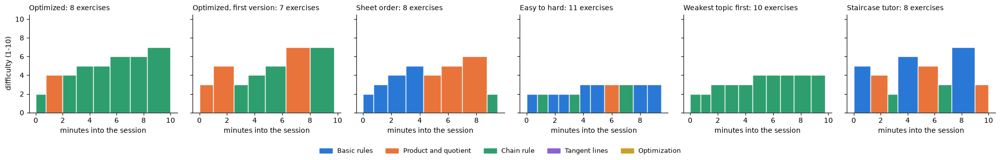
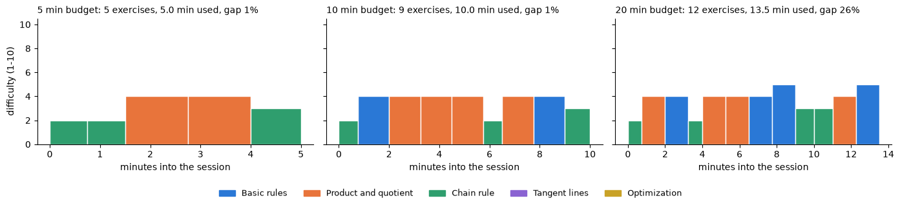

# Designing an Exercise Path for Learning Gain in Limited Time

**Group 3, Milestone 3: UI Optimization.** Code: `ui_optimization.ipynb`.

**Declaration of Use of AI.** We used Claude (through Claude Code) to help build the exercise bank, to turn our formulation into mathematics and Gurobi code, and to improve the wording of this report. The task, the modelling choices and the conclusions are ours.

## Section 1: Overview of the task

Our project asks when help is actually helpful for students who study with AI. In our need-finding (Milestone 1), students under time pressure said they still need to learn and not only finish, that they need room to struggle with a problem before help arrives, and that they need to understand an idea well enough to solve similar problems alone. Well-chosen practice exercises support all three, but with only a few minutes someone has to decide which exercises to do, in which order. This is the task we optimize.

**Task.** Given the topics a student wants to practice, a time budget (5, 10 or 20 minutes), the student's self-rating of each topic and, as they practice, their results, we choose an ordered list of exercises from a bank. **Why it needs optimization.** The right exercise is not too easy, because it teaches nothing, and not too hard, because it frustrates and invites handing the problem over to someone else, an AI included. What is right changes as the student practices: their level rises, a failed exercise calls for a related one, and near-identical exercises waste time. A fixed rule such as "easy to hard" cannot weigh all of this for each student.

**Formulation and result.** The design variables are which exercise is placed at each position of the path. The objective is the learning gained over the session, estimated from a student model, with penalties for near-duplicates and for generated exercises, and a bonus for exercises related to one just failed. We solve an integer program with Gurobi over a bank of 100 exercises on five derivative topics. For an example student with 10 minutes it returns a 9-exercise path, proven optimal by the solver, that starts easy in the topic rated lowest. In simulation it clearly outperforms rules that ignore the student's ratings and results. All data are made up: the exercise bank, the simulated students and the learning rules are our own assumptions.

## Section 2: Definition of variables and constraints

In words: we choose a short list of exercises and put them in order. A list is valid if no exercise appears twice, the positions are filled without gaps, and the estimated times add up to at most the budget.

**The exercise bank.** The optimization takes the bank as input, so it works for any course. In use, the bank is built from the exercises the student provides from their own course material, split and tagged by a language model, and exercises generated by a language model to fill gaps. Generated exercises are marked and discouraged by a penalty, so the student's own come first. For each exercise the model needs only a topic, a difficulty, a time, a source flag and knowledge tags. The Calculus bank used here is one example of what such a bank looks like.

**Notation.** $E$ is the set of candidate exercises: the best 4 of each chosen topic, at most 20 (a larger pool is too slow to solve, see Section 4). Positions are $t = 1,\dots,S$ and $E_c$ are the exercises of topic $c$. Each exercise $e$ has minutes $m_e$, a flag $\gamma_e = 1$ if generated, and similarities $\mathrm{sim}(e,f)$ to others (overlap of knowledge tags). $B$ is the budget.

**Decision variables.** $x_{et} \in \{0,1\}$ is 1 if exercise $e$ is placed at position $t$, and $z_e = \sum_t x_{et}$. Three auxiliary variables are used: $y_{ef} \ge 0$ for two near-duplicates chosen together, $g_{ct}$ for the learning gained in topic $c$ at position $t$, and $A_{ct}$ for the ability already gained in topic $c$ before position $t$.

**Constraints.**

$$
\sum_e x_{et} \le 1 \;\forall t, \qquad \sum_e x_{e,t+1} \le \sum_e x_{et} \;\forall t, \qquad z_e \le 1 \;\forall e, \qquad \sum_e m_e z_e \le B, \qquad \sum_e z_e \ge 1
$$

$$
y_{ef} \ge z_e + z_f - 1 \;\;\text{for pairs with } \mathrm{sim}(e,f) > 0.6
$$

$$
A_{c,1} = 0, \quad A_{c,t+1} = A_{ct} + \eta\, g_{ct}, \quad g_{ct} \le M \sum_{e \in E_c} x_{et}, \quad g_{ct} \le v_e + \sigma_e A_{ct} + 2M(1 - x_{et}) \;\;\forall e \in E_c
$$

The first line says: one exercise per position, no gaps, each at most once, within the time budget. The second counts near-duplicate pairs. The third is the learning progress: the level in topic $c$ rises by $\eta$ times the learning gained, and the value of $e$ at position $t$ is its value now ($v_e$) plus a first-order correction $\sigma_e A_{ct}$ for the ability gained so far, valid only where $e$ is placed. Here $\sigma_e$ is the slope of $v_e$ (not the logistic function), $\eta = 0.35$ is the ability gained per unit of learning, and $M = 4$ is an upper bound on learning at one position, which makes the last constraint inactive wherever $x_{et} = 0$.

## Section 3: Definition of objective functions

**Student model (computed before the solve, so the program stays linear).** All abilities and difficulties are on one 0 to 10 scale. $d_e$ is the **difficulty** of exercise $e$ (our estimate, 1 = routine, 10 = hardest in the bank). The **ability** $a$ of a student is the difficulty at which they succeed about half of the time. $r_c$ is the **self-rating** the student gives topic $c$ (0 = never seen it, 10 = could explain it), and $\rho_j$ is the **result** on an attempted exercise $j$ (0.9 solved alone, 0.7 with a hint, 0.4 needed the solution). $\mathrm{sim}(e,f) \in [0,1]$ is the similarity of two exercises. Let $\sigma(x) = 1/(1+e^{-x})$ be the logistic function, which turns a number into a probability, and $\mathrm{logit}(p) = \ln\frac{p}{1-p}$ its inverse. Each result suggests an ability $a_j = d_j + s\,\mathrm{logit}(\rho_j)$, where the scale $s = 1.5$ means that an ability $s$ points above the difficulty gives a 73% chance of success. We estimate the ability near exercise $e$ as a mix of the estimate for its topic and the similar attempts:

$$
a_e = \frac{W_1\, a_{c(e)} + \sum_j \mathrm{sim}(e,j)\, a_j}{W_1 + \sum_j \mathrm{sim}(e,j)}, \qquad a_c = \frac{w_0 (r_c + b) + \sum_{j \in c} a_j}{w_0 + n_c}, \qquad b = \frac{\sum_j (a_j - r_{c(j)})}{B_0 + n}
$$

Here $n_c$ and $n$ count the attempts in topic $c$ and in all topics, $b$ is a bias shared by all topics (rating too high everywhere), and the weights $w_0 = W_1 = B_0 = 2$ say how many attempts the self-rating, the topic estimate and the damping are worth. The self-rating is only a starting guess: results in the topic correct it, and results on similar exercises correct it more. The chance of solving $e$ alone is $p_e = \sigma((a_e - d_e)/s)$, the logistic (Rasch) model of item response theory [1].

**Value of an exercise.** We assume learning is largest at a moderate chance of success, with a smaller loss for an exercise a bit too easy than a bit too hard. Simple learning algorithms learn fastest at about 85% success [2], and practice should be demanding but doable [3]; we take the more demanding $p^* = 0.6$, because students can use hints, and have no data to confirm it. With $q(p) = p^3 (1-p)^2 / (0.6^3 \cdot 0.4^2)$, which is 1 at $p^* = 0.6$ and falls on both sides, $\mathrm{room}_e = (10 - a_e)/10$ (how much is left to learn) and $m_e$ the minutes of the exercise:

$$
v_e = \big(q(p_e)\,(0.4 + 0.6\,\mathrm{room}_e) + 0.05\big)\,(m_e / 1.25)^{0.5}
$$

The 0.05 gives every exercise a small value, and the last factor makes longer exercises worth more (1.25 minutes is a typical exercise). $\sigma_e$ in Section 2 is the change of $v_e$ when the ability rises by one point.

**Objective.** $h_e$ is 0.3 times the similarity of $e$ to an exercise the student already solved (if above 0.6), and $\mathrm{rem}_e$ is a bonus, 0.8 times the similarity to the exercise just failed, scaled by how badly it was failed:

$$
\max \;\; \sum_{c,t} g_{ct} + \sum_e \mathrm{rem}_e\, x_{e1} - \sum_{e,t} h_e\, x_{et} - \lambda_{\text{gen}} \sum_e \gamma_e z_e - \lambda_{\text{red}} \sum_{e<f} \mathrm{sim}(e,f)\, y_{ef}
$$

**Assumptions.** All constants are assumptions that we could not measure: $s$, $w_0$, $W_1$, $B_0$, $p^* = 0.6$, $\lambda_{\text{gen}} = 0.15$, $\lambda_{\text{red}} = 0.4$ and the weights 0.3 and 0.8. In the example bank, the difficulty, time and tags of the 100 exercises (39 of them generated) are our own estimates. In use they would be language-model estimates, which we would cite.

## Section 4: Analysis of the resulting designs

**Final design.** The example student rates basic rules 5, product and quotient 4 and chain rule 2, and has 10 minutes. The path has 9 exercises and uses the whole budget. It starts with difficulty 2 in the weakest topic, chain rule, and moves to difficulty 4 in the other two, and most exercises have an estimated chance of success of 50 to 66%. The solver proves the plan is within 1% of the optimum (6 seconds). Figure 1 shows how each design would continue if every answer were correct: the optimized design is re-planned after each answer, so its difficulty rises with the modelled level, to 7.

{width=100%}

**Reference designs.** We compare with four designs a person could make: *sheet order*, *easy to hard*, *weakest topic first*, and a *staircase tutor* (one level up after a clean solve, down after a miss). *First version* is our design before the change below. We simulated 20 students. Each has a true ability per topic that the planner cannot see, and a self-rating that is the true ability plus a random error (about 1.5 points shared by all topics and 1 per topic, our assumption), as real self-ratings are rarely exact. They also slip, and are faster or slower than estimated. We use two assumed learning worlds: in the ramp world a student learns more from exercises further above their level, in the peak world most when the chance of success is about one half. We measure the mean true ability gain per topic.

| Design | ramp world | peak world | Exercises done |
|---|---|---|---|
| **Optimized** | **0.234** | 0.260 | 7.1 |
| First version | 0.216 | 0.259 | 7.2 |
| Sheet order | 0.115 | 0.225 | 8.0 |
| Easy to hard | 0.083 | 0.214 | 12.4 |
| Weakest topic first | 0.199 | 0.280 | 10.2 |
| Staircase tutor | 0.184 | 0.260 | 7.0 |

Standard errors are 0.02 to 0.035. The optimized design is clearly better than *sheet order* and *easy to hard* in the ramp world, which ignore the student. The difference to *weakest topic first* and the *staircase* is within noise, and in the peak world, which is closest to what the optimizer assumes, all designs are within noise. It responds to the student: rating everything 3 gives 11 exercises at difficulty 2 to 3, rating everything 8 gives 6 at difficulty 6 to 7, while sheet order and easy to hard give both the same path. In a what-if analysis on the budget (Figure 2), the plan grows from 5 to 9 to 12 exercises and the mean difficulty from 3.0 to 3.7 as the modelled level rises along a longer path. The 20-minute plan uses 13.5 minutes, because the pool has only 12 candidates.

The simple rules ignore near-duplicates. For 30 simulated students the first plan of the optimized design has 0.4 near-duplicate pairs against 1.4 to 6.1 for the rules. It is not ahead on other measures: it uses 86% of the time (94 to 98% for the rules) and 33% generated exercises (7% for easy to hard).

{width=65%}

**Critical examination.** Our first version kept the 12 best exercises overall as candidates, and a student with five topics got a plan of almost only one topic (three of five, objective 6.18): the chain rule and optimization, which the student rated lowest, never entered the model. We now keep the best 4 of each topic. For a student who chose all five topics, the plan then covers four topics with objective 7.50 on the same scale, and over 14 random students the number of topics covered rose from 2.1 to 2.8. The price is a harder solve: for 10 and 20 minutes the solver stops at its 4-second limit without a proof, so we re-solve after each answer. The solver matches brute force on six small cases, and the first-order approximation differs from the exact update by 2.0% on average. In Milestone 4 the optimized design is one variant of the A/B test, where we will record success and time per exercise to estimate $\eta$, $p^*$ and the time scale.

**References.** [1] Rasch (1960), *Probabilistic Models for Some Intelligence and Attainment Tests*. [2] Wilson et al. (2019), The Eighty Five Percent Rule for optimal learning, *Nature Communications* 10, 4646. [3] Bjork and Bjork (2011), Making things hard on yourself, but in a good way, in *Psychology and the Real World*.
